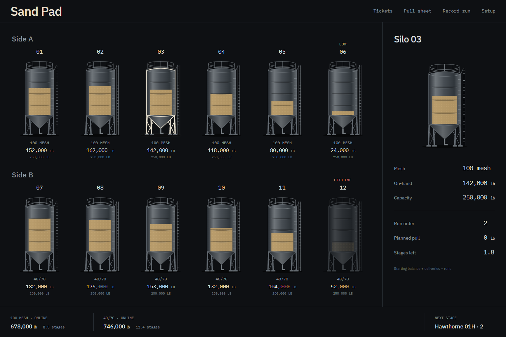

# Sand Pad

A local frac-sand pad tracker. The yard is the primary surface: select a steel silo to inspect its balance or work with tickets and stage pulls.

## Run

Requires Node.js 22.12+ (Node.js 24 recommended).

```sh
npm ci
npm run dev
```

Open http://localhost:5173. One command runs Vite and the Express API at `127.0.0.1:3001`. The first API startup creates `data/sand-pad.sqlite` with a demo pad: 6 silos, two sides, two meshes, two wells, two tickets and two runs. Subsequent starts preserve the ledger. No external credentials or services are required. IBM Plex fonts are bundled locally.

```sh
npm test
npx playwright install chromium
npm run test:e2e
npm run build
npm start
```

The production server serves the built client and API at http://127.0.0.1:3001. `SAND_PAD_DB` optionally sets a different SQLite file; `PORT` changes the API port (update the Vite proxy if using a different development API port). Setup's **Download SQLite** button produces a consistent backup of the whole database, including every pad and changes in the WAL. Local databases, dependencies, and builds are excluded from Git.

## Operations

- **Pad:** two yard rows. Hover or keyboard-focus a silo to read pounds and stages; click for its rail. Low means less than one stage in that tank. Offline stock is shown but excluded from stage planning and reorder coverage.
- **Tickets:** click a receiving silo, enter its delivery, save. Mesh follows the silo assignment unless a saved mine-code mapping fills it. A mapped mesh must match the selected silo before saving. The optional remember checkbox saves the mapping for the next ticket. Duplicate active ticket numbers are checked case-insensitively within the pad; explicit confirmation is required before a duplicate save. Product code is optional. Capacity overflow is rejected.
- **Pull sheet:** the next unfinished well/stage, with each mesh's remaining design pounds allocated in draw order. Print prints the sheet alone. Shortfalls are visible rather than silently reducing the required stage pounds.
- **Record run:** enter the run date, select a mesh and click one or more online tanks. Adjust pounds per tank and save the entire pull atomically. Before/after balances remain visible. A stage captures its mesh design on the first run and advances once all those meshes meet design pounds. Partial runs count toward completion; additional runs and corrected stage/well selections are permitted, but inventory cannot go below zero.
- **Log:** filter tickets and runs by date and type, with silo, mesh, well and stage. Edit a record or confirm its void here. Every successful change returns recomputed inventory. Voided records remain visible and are excluded from balances, rotation and stage completion. Original values for edits and voids are retained in the database audit table. Corrections are rejected if they would leave any affected silo below zero or above capacity. Voiding or reducing a completed run can reopen that stage.
- **Stage history:** in Log, compare pumped and captured design pounds by well, stage and mesh. Short means at least one mesh is below design, including a partially recorded stage. Later mesh design edits affect new stages, while recorded stage designs remain stable. The first migration captures the legacy stages' design using the existing setup; historical design changes before this release were not recorded. Legacy runs without dates are labeled **Undated legacy**, rather than assigned an invented date; date filters exclude them. Enter the actual date when editing an undated run.
- **Setup:** add or edit wells, meshes and silos, adjust the reserve (default five stages), offline status and optional pins. A silo with ledger history (including voids) cannot change mesh. Starting-balance changes affect the computed balance and are validated against capacity. Create pads, manage suppliers and mine-code mappings and download SQLite here.
- **Pad switcher:** the header selects the pad. The selection is recorded in the URL so a reload retains it. Creating a pad preserves every existing pad's ledger. Optionally copy wells, meshes and silo setup, with zero starting balances and no deliveries or runs copied. Job settings, well overrides, suppliers and mine-code mappings are copied. Each pad has its own reserve, inventory, stage history and mappings.

## Inventory and draw rules

On-hand is always `starting_balance + SUM(active deliveries) - SUM(active runs)`. It is computed, never persisted as an authoritative field. Tank fill and silo stages use this balance. Mesh reorder coverage uses online pounds divided by design pounds per stage; offline inventory is excluded from available coverage.

Sequential rotation begins after the most recently used silo of that mesh and wraps by silo number. Manual pins draw first in ascending pin order; unpinned tanks follow the rotation. Conflicting pins on online tanks of the same mesh are flagged in the rail; the rotation supplies a deterministic tie-break. Allocation spans additional tanks when necessary. Each API save returns a fresh computed pad snapshot, so the React app updates without a reload.

The local Express API is the only data connection from React. SQLite uses foreign keys, WAL journaling and transactions. The five domain tables are `wells`, `sand_types`, `silos`, `deliveries`, and `runs`; `pads`, `settings`, `stage_designs`, `mine_codes`, `well_designs`, `suppliers` and `ledger_edits` provide pad scope, history, mappings and audit. One database contains all pads. Existing databases migrate transactionally to the first pad while retaining ledger IDs and balances. No Firebase, Firestore, Google GenAI, AI Studio applet configuration, or ticket scanner is included. The server binds to loopback for local use.

Tests cover ledger arithmetic, rotation/pins, offline reserve, partial and complete stages, duplicate tickets, over-capacity deliveries, atomic overdraw rejection, migration and restart preservation, edit/void rollback, pad isolation, historical design, mappings and a downloaded database integrity check. Browser tests exercise all original screens and the six new workflows at desktop and mobile sizes.

The browser test starts its own temporary API with an in-memory database, so it does not modify the local demo ledger. Set `PLAYWRIGHT_CHANNEL=msedge` to use installed Edge instead of downloaded Chromium. Screenshots and test outputs go to the ignored `qa/` directory.



## Real job setup

Pad identity stores customer, pounds per ton (2000), pounds per truckload (57000), reserve (5), draw strategy and stage options. Wells can inherit or override the pad toe option; toe is stage 0 and adds one designed stage. Each well can override mesh pounds per stage, including zero for a mesh not used on that well. Job design compares planned pounds (including toe and well overrides), whole-job design totals, and active pumped pounds. Completed stage design snapshots remain fixed after later setup edits.

Available strategies are sequential rotation, partials then rotation, least cumulative pounds used, emptiest percent first, fullest percent first, and six silo positions 6, 2, 5, 1, then 4, 3. Manual pins precede any strategy. Clear-pins applies only once all meshes meet the captured stage design. Turning auto-advance off holds the last recorded well/stage and exposes a current-stage selector in Setup.

Removing a well or silo retires it from the active job. Removal with any ledger history requires confirmation, and ledger rows, names and stage history remain available in Log. Silo numbers stay reserved by retired silos so historical identities remain unambiguous. Supplier choices are saved per pad; a new supplier can be added during ticket entry. Mine codes map directly to mesh independently of supplier.

Pads allow at most six active silos, including offline silos. Setup disables Add silo at the limit and the API enforces it. Retiring a silo frees a slot without removing ledger rows. Existing job equipment is preserved; an older pad above the limit must retire excess silos before copying setup. The unchanged original demo is reduced to six active silos while retaining retired equipment and its history.
